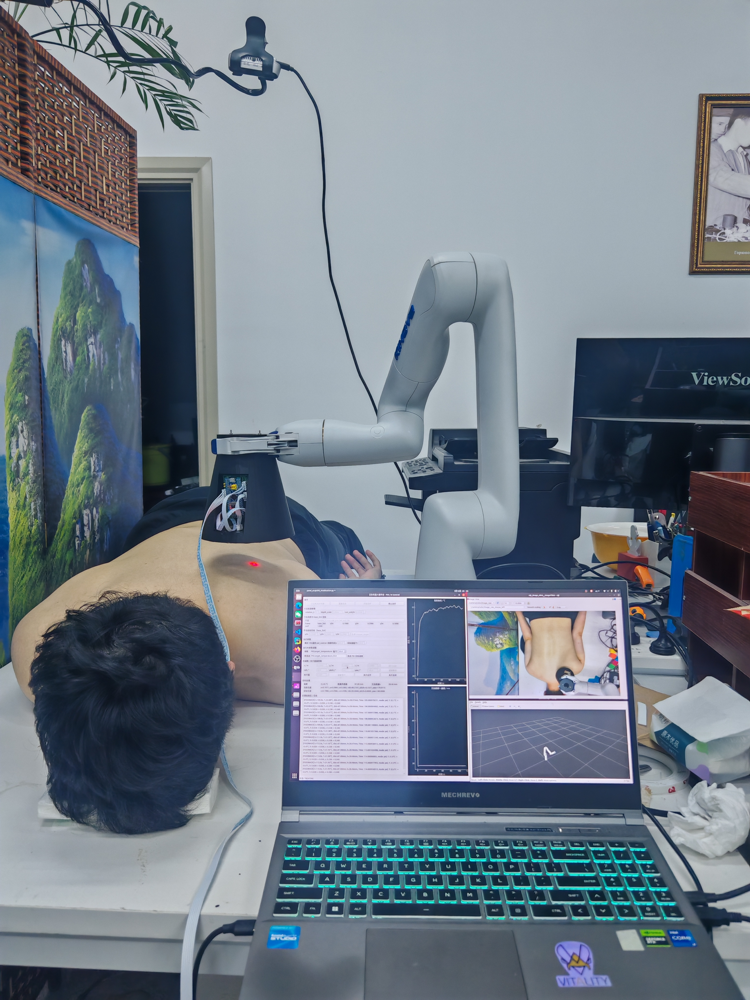
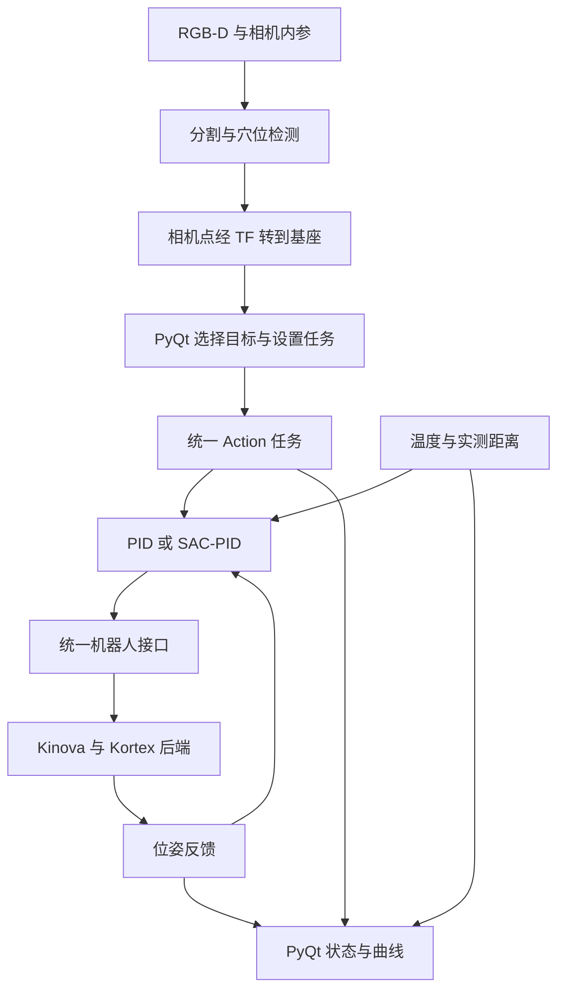
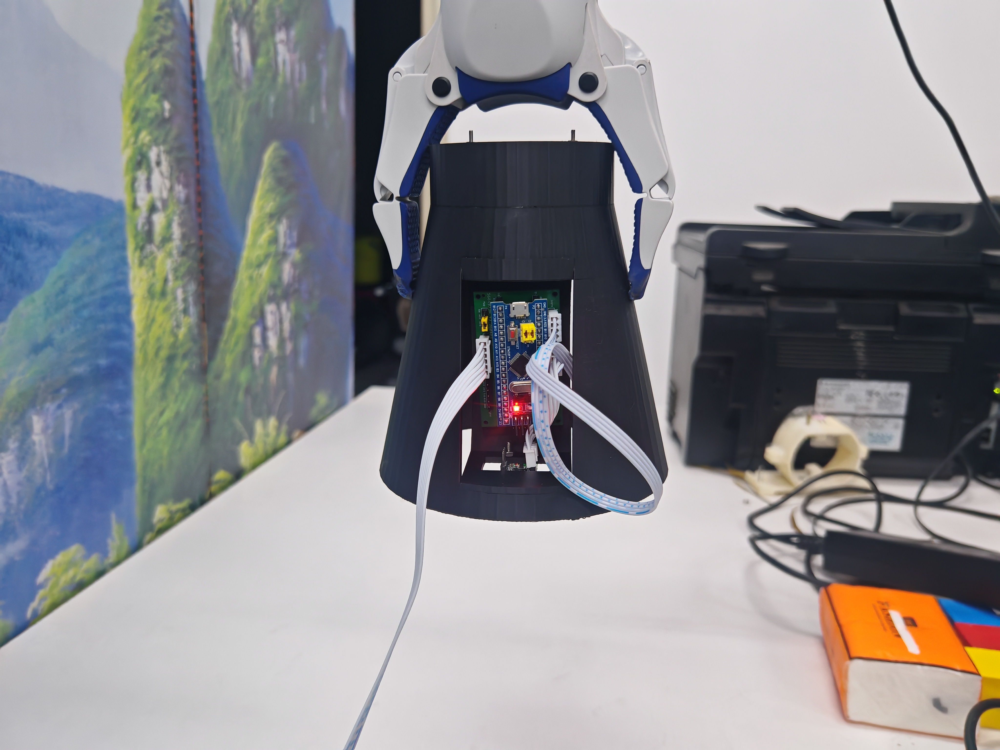
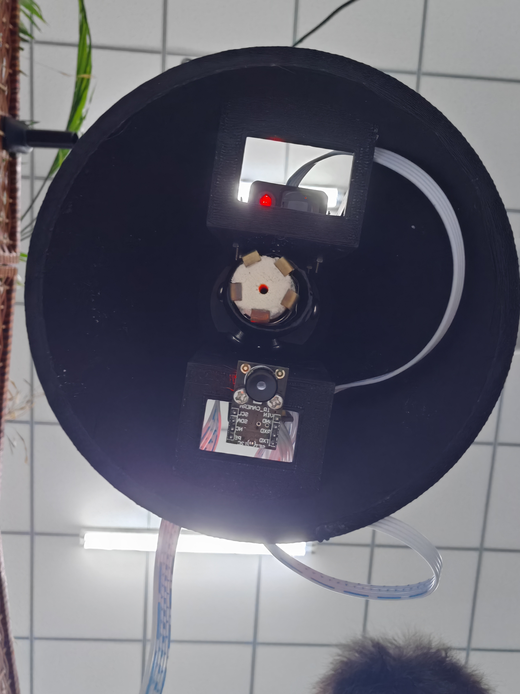
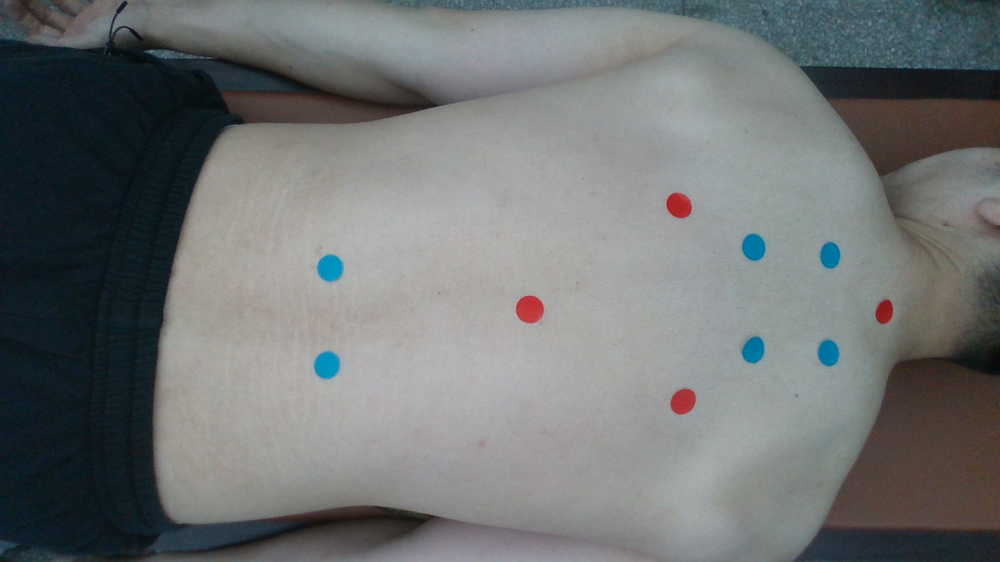
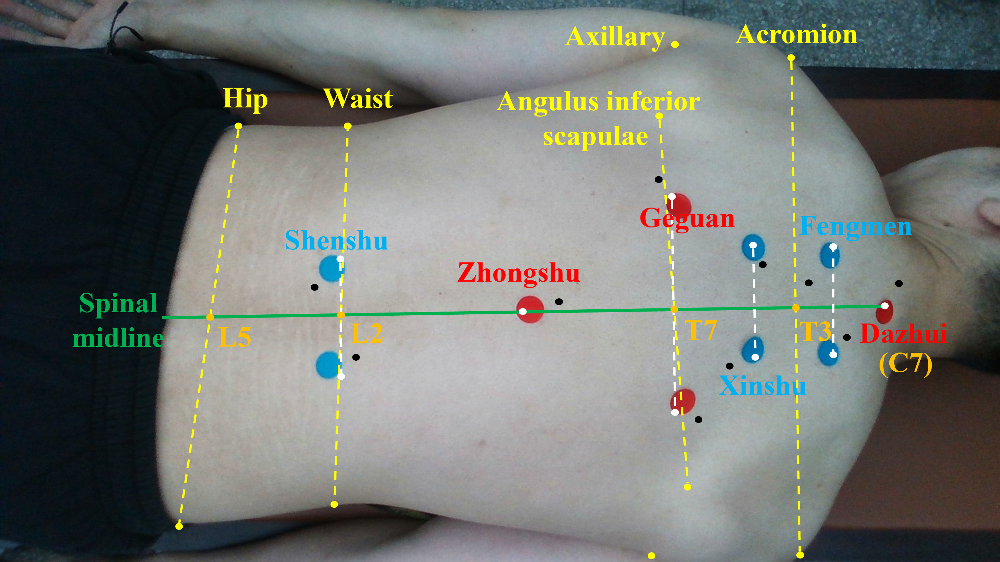

# 艾灸机器人

基于 RGB-D 视觉、温度与距离反馈的艾灸机器人研究系统，提供穴位定位、机器人任务执行和 PyQt 整机操作界面。

<p align="center">
  
</p>

整机研究装置实拍：Kinova 机械臂搭载自制艾灸末端，固定相机观察背部区域，电脑负责视觉处理、任务控制与界面显示。

## 项目介绍

本项目围绕艾灸过程中的穴位定位与温度控制展开：利用 RGB-D 图像识别背部区域和人体关键点，结合脊柱几何与同身寸规则计算穴位，再通过相机外参将目标转换到机器人基座坐标。在任务执行过程中，根据温度、实测距离和机器人位姿反馈调整末端位置。

当前系统采用 ROS Noetic、Kinova Gen3 Lite 和 Intel RealSense D435i。用户可以在 PyQt 操作台中自动检测穴位、从图像选点或直接输入基座坐标，选择 PID / SAC-PID 并发起单穴位任务。任务层通过统一机器人接口访问后端；接入其他机械臂时，需要实现对应的状态、移动和停止接口。

| 功能包 | 职责 |
| --- | --- |
| [`acupoint_detection`](acupoint_detection) | VGG16-UNet 背部分割、基础 HRNet `add_mask` 关键点检测、OLS 脊柱拟合与穴位计算 |
| [`system_integration`](system_integration) | 相机输入、运行期外参 TF、图像选点、基座坐标转换、PyQt 操作台与整机启动 |
| [`moxibustion_api`](moxibustion_api) | 单穴位 Action、PID / SAC-PID、温度与距离串口输入 |
| [`moxa_robot_interface`](moxa_robot_interface) | 标准位姿状态、同步点目标移动、停止及可选能力接口 |
| [`kinova_controller`](kinova_controller) | Kinova / Kortex 控制后端与统一接口适配 |

## 运行环境

| 项目 | 配置 |
| --- | --- |
| 操作系统 / ROS | Ubuntu 20.04 / ROS Noetic |
| Python | Python 3；参考环境为 3.8.10 |
| 机械臂 | Kinova Gen3 Lite，外部 ROS1 Kortex 驱动 |
| 相机 | Intel RealSense D435i，ROS1 `realsense2_camera` 与 librealsense2 |
| 末端与采集 | 自制艾灸执行器，温度与距离采集模块，经串口发送 `SENS` 数据帧 |
| 视觉计算 | NVIDIA GPU 与兼容的驱动；完整视觉链中的 UNet 要求 CUDA |
| 推理依赖 | PyTorch / torchvision；参考组合为 2.2.2 / 0.17.2、CUDA 12.1 wheel |
| 图像与数值处理 | NumPy、OpenCV、scikit-image、scikit-learn、cv_bridge |
| 界面与通信 | PyQt5、pyqtgraph、TF / TF2、actionlib、pyserial、PyYAML |


## 整体流程




## 配置与启动

### 1. 获取代码并准备依赖

以下使用独立运行工作区 `~/moxa_run_ws`，模型和现场配置放在 `~/moxa_resources`：

```bash
source /opt/ros/noetic/setup.bash
sudo apt install git curl build-essential python3-pip python3-rosdep \
  ros-noetic-realsense2-camera

mkdir -p ~/moxa_run_ws/src ~/moxa_resources/models ~/moxa_resources/config
cd ~/moxa_run_ws/src
git clone https://github.com/KusanagiNaoya/moxibustion-robot.git
git clone -b noetic-devel https://github.com/Kinovarobotics/ros_kortex.git
```

RealSense 使用 [ROS1 驱动](https://github.com/realsenseai/realsense-ros/tree/ros1-legacy)。Kortex 的 `noetic-devel` 使用 Conan 1.x 获取驱动所需资源，按[上游安装说明](https://github.com/Kinovarobotics/ros_kortex/tree/noetic-devel)准备；首次配置可用：

```bash
python3 -m pip install --user conan==1.59.0
export PATH="$HOME/.local/bin:$PATH"
conan config set general.revisions_enabled=1
conan profile new default --detect
conan profile update settings.compiler.libcxx=libstdc++11 default
```

已有 Conan `default` profile 时，检查并使用现有配置，不重复创建。然后安装 ROS 与 Python 运行依赖：

```bash
sudo rosdep init

rosdep update --include-eol-distros
cd ~/moxa_run_ws
rosdep install --from-paths src --ignore-src -y --rosdistro noetic \
  --skip-keys "python3-torch python3-torchvision"

python3 -m pip install --user torch==2.2.2 torchvision==0.17.2 \
  --index-url https://download.pytorch.org/whl/cu121
```

### 2. 构建并加载运行环境

在运行工作区构建，随后明确加载它的环境：

```bash
source /opt/ros/noetic/setup.bash
cd ~/moxa_run_ws
catkin_make
source ~/moxa_run_ws/devel/setup.bash

rospack find acupoint_detection
rospack find system_integration
rospack find moxibustion_api
rospack find moxa_robot_interface
rospack find kinova_controller
rospack find kortex_driver
rospack find realsense2_camera
```

### 3. 下载模型资源

从 [models-v1 Release](https://github.com/KusanagiNaoya/moxibustion-robot/releases/tag/models-v1) 下载两份视觉权重：

```bash
curl -fL https://github.com/KusanagiNaoya/moxibustion-robot/releases/download/models-v1/unet_weights.pth \
  -o ~/moxa_resources/models/unet_weights.pth
curl -fL https://github.com/KusanagiNaoya/moxibustion-robot/releases/download/models-v1/hrnet_weights.pth \
  -o ~/moxa_resources/models/hrnet_weights.pth
```

| 资源 | 用途与配置 |
| --- | --- |
| `unet_weights.pth` | 7 类 VGG16-UNet 分割，通过 `unet_weights` 指定路径 |
| `hrnet_weights.pth` | 基础 HRNet W32、11 个关键点、RGB 加掩膜输入，通过 `hrnet_weights` 指定路径；对应 `add_mask` 路线 |
| [`sac_pid.zip`](moxibustion_api/models/sac_pid.zip) 与 [`config.yaml`](moxibustion_api/models/config.yaml) | 随源码提供，位于 `moxibustion_api/models/`，SAC-PID 使用该目录 |
| [`acupoint_info.csv`](acupoint_detection/config/acupoint_info.csv) | 穴位名称和定位规则，随源码提供；可用 `acupoints_file` 指定其他规则文件 |

### 4. 配置机械臂与传感器

将运行电脑连接到机械臂网络，在**启动整机的终端**输入设备连接信息：

```bash
read -r -p "Kinova IP: " KORTEX_IP_ADDRESS
read -r -p "Kinova username: " KORTEX_USERNAME
read -r -s -p "Kinova password: " KORTEX_PASSWORD
printf '\n'
export KORTEX_IP_ADDRESS KORTEX_USERNAME KORTEX_PASSWORD
```

整机入口从这三个环境变量取得连接信息。`robot_name` 默认为 `my_gen3_lite`，统一接口命名空间默认为 `/moxa_robot`。Home 和夹爪默认关闭，按需用 `enable_home:=true`、`enable_gripper:=true` 启用。

复制传感器配置到资源目录，再编辑本地副本：

```bash
cp ~/moxa_run_ws/src/moxibustion-robot/moxibustion_api/config/sensors.yaml \
  ~/moxa_resources/config/sensors.yaml
ls -l /dev/serial/by-id/
```

在 `sensors.yaml` 中设置实际设备路径和波特率，例如：

```yaml
port: /dev/serial/by-id/替换为实际设备标识
baudrate: 115200
```


| 执行器正视 | 执行器底部 |
| --- | --- |
|  |  |

研究装置中的自制末端及采集部件。该装置使用 MLX90640、激光测距模块与 STM32 采集电路。

### 5. 配置相机外参与任务参数

复制外参结构、任务参数和 GUI 配置：

```bash
cp ~/moxa_run_ws/src/moxibustion-robot/system_integration/config/hand_eye.example.yaml \
  ~/moxa_resources/config/hand_eye.yaml
cp ~/moxa_run_ws/src/moxibustion-robot/moxibustion_api/config/control.yaml \
  ~/moxa_resources/config/control.yaml
cp ~/moxa_run_ws/src/moxibustion-robot/system_integration/config/gui.yaml \
  ~/moxa_resources/config/gui.yaml
```

**相机外参。** 系统使用固定相机的 eye-to-hand 关系，`B_T_C` 将相机光学坐标中的米制点变换到机器人基座：

```yaml
base_frame: base_link
camera_frame: camera_color_optical_frame
B_T_C:
  translation: {x: null, y: null, z: null}
  rotation:
    quaternion: {x: null, y: null, z: null, w: null}
```

将 `null` 全部替换为实际标定结果；平移单位为 m，四元数顺序为 `x, y, z, w`，须为单位四元数。

**任务几何。** 打开 `control.yaml`，核对下列配置与实际安装、工作区域一致：

| 参数 | 源码默认值 | 含义 |
| --- | --- | --- |
| `initial_z_m` | `0.30` m | 准备点的基座绝对 Z；XY 来自所选穴位，姿态来自任务开始时的反馈 |
| `x_min_m` / `x_max_m` | `0.00` / `0.40` m | 目标 X 范围 |
| `y_min_m` / `y_max_m` | `0.00` / `0.40` m | 目标 Y 范围 |
| `z_min_m` / `z_max_m` | `0.01` / `0.50` m | 机器人目标 Z 范围 |
| `D_setup` / `D_raw` | `0.037` / `0.011` m | 测距安装换算参数，`h = r - D_setup + D_raw` |
| `distance_min_m` / `distance_max_m` | `0.03` / `0.08` m | 控制间距范围 |
| `positive_z_increases_distance` | `true` | 当前固定安装姿态下，基座 +Z 增大间距 |

### 6. 启动系统

在已加载运行工作区、设置 Kortex 环境变量的终端启动：

```bash
roslaunch system_integration system.launch \
  unet_weights:="$HOME/moxa_resources/models/unet_weights.pth" \
  hrnet_weights:="$HOME/moxa_resources/models/hrnet_weights.pth" \
  calibration_file:="$HOME/moxa_resources/config/hand_eye.yaml" \
  task_config:="$HOME/moxa_resources/config/control.yaml" \
  sensor_config:="$HOME/moxa_resources/config/sensors.yaml" \
  gui_config:="$HOME/moxa_resources/config/gui.yaml"
```
<details>
<summary>模块开关、相机话题与分模块启动</summary>

| 整机参数 | 默认值 / 用途 |
| --- | --- |
| `start_camera`、`start_vision`、`publish_extrinsics` | 均为 `true`，控制相机、视觉服务和外参发布 |
| `start_sensors`、`start_robot`、`start_api`、`start_gui` | 均为 `true`，控制对应模块是否由此次 launch 启动 |
| `base_frame` / `camera_frame` | `base_link` / `camera_color_optical_frame` |
| `robot_name` / `robot_interface_ns` | `my_gen3_lite` / `/moxa_robot` |
| `camera` / `serial_no` | `camera` / 空；多相机时填写设备序列号 |
| `resolution_mode` | `720p`，1280×720、30 FPS；其他值选用 640×480 |
| `color_topic` | `/camera/color/image_raw` |
| `depth_topic` | `/camera/aligned_depth_to_color/image_raw` |
| `camera_info_topic` | `/camera/color/camera_info` |
| `sensor_port` | 空时使用 `sensor_config` 的端口；非空时覆盖 |
| `sensor_topic` / `action_name` | `/moxibustion_api/sensor/sample` / `/moxibustion_task` |

</details>

## 使用方法

### 1. 生成并选择任务目标

在 GUI 的相机区域检查取景，在检测参数中设置图像方向、尺寸比和同身寸。完成后，穴位选择区应显示目标名称、坐标系和米制 XYZ。自动检测的图像显示在 **检测结果** 页签；无效深度或无法转换的点不会作为有效三维目标提交。

| 彩色输入示例 | 背部分割示例 |
| --- | --- |
|  |  |

穴位定位示例：



### 2. 设置参数并开始任务

在 **治疗参数（开始前设置）** 中设置：

| 项目 | 可选值与含义 |
| --- | --- |
| 方法 | **PID** → `pid_control`，默认；**SAC-PID** → `sac_pid_control` |
| 滤波平均温度 / °C | 默认 43 °C，允许范围来自任务配置，默认 25–50 °C |
| 时长 / s | 默认 60 s；GUI 范围 0–600 s，0 表示持续到取消 |

SAC-PID 根据观测调整 PID 增益，两种方法共用同一个任务流程。GUI 初始方法来自 `control.yaml` 的 `default_mode`，任务采用开始时提交的选择。方法、目标温度和时长在开始前确定，界面不提供运行中切换或调温。

核对所选穴位、准备高度和工作范围，确认状态栏中的 Action 连接与机器人反馈有效，然后点击 **开始治疗** 并确认对话框。任务先移动到准备点，再进入温控；任务时长从温控阶段开始计。

### 3. 查看结果、取消任务与退出

实时反馈区显示滤波平均温度、原始测距 `r`、任务反馈间距 `h`、机器人位姿和任务目标位姿；曲线显示温度与距离。距离单位为 m，温度为 °C。

| 操作或结果 | 系统行为 |
| --- | --- |
| 达到任务时长 | 服务器请求停止后返回任务结果；正常完成为 `SUCCEEDED` 且 `success=true` |
| **取消治疗** | 进入 `CANCELING`，等待服务器终态；正常取消为 `PREEMPTED`，结果的 `success=false` 表示任务未完成 |
| **请求机器人停止** | 独立发送停止请求，同时取消界面当前任务；GUI 进入 `UNKNOWN`，运动控件保持锁定 |
| 异常结果或通信中断 | 显示收到的错误信息并保持互斥，不自动恢复运动控件 |

<details>
<summary>手动运动、Home 与夹爪</summary>

空闲且机器人反馈有效时，先点击 **从有效反馈填入位姿**，再编辑位置或姿态，点击 **请求移动**。XYZ 单位为 m，显示角度为固定轴 XYZ（`sxyz`）的 RPY，单位为度；接口发送四元数。

Home 和夹爪仅在启动参数启用、相应服务可用且没有冲突任务时开放。夹爪可以 **设置夹爪**、**全开**、**全闭**；输入为目标位置，接口没有实际夹爪位置反馈。初始化控件、刷新位姿和调整显示值本身不触发运动。

</details>

## 常见问题

待补充

## 相关研究

Zheng Zhang, Qiang Wang, Qi Liu. *An Acupoint Localization System Based on Multimodal Vision and Meridian Theory*. 2026 IEEE International Instrumentation and Measurement Technology Conference (I2MTC), pp. 1–6. [DOI: 10.1109/I2MTC66907.2026.11694641](https://doi.org/10.1109/I2MTC66907.2026.11694641)。
